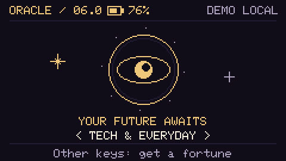

# Cardputer Oracle

**A pocket fortune teller for M5Stack Cardputer ADV, with witty predictions, spoken fortunes, mystical cats and a printed keepsake.**

Press a key, watch the ritual, hear your fortune and take it away on a thermal receipt. Designed for everyday use, meetups and a little entertainment with friends.

## Four themes

| Theme | Content | Internet |
| --- | --- | --- |
| Tech & everyday | 60 fortunes about work and life | No |
| Beer | 30 fortunes for a relaxed evening | No |
| Tea | 30 fortunes about tea and small rituals | No |
| Tarot / AI | Your question, three different cards and a fresh reading | Wi-Fi + LiteLLM |

- **120 fortunes per language**, with pre-generated WAV narration. English, Russian and Simplified Chinese use the same stable card IDs and artwork.
- **English by default**; choose Russian or Simplified Chinese at build time. The choice covers interface, fallback cards, SD text, narration, Tarot output and printed receipts.
- Each offline theme has its own shuffled queue without repeats until the deck is exhausted. Only the selected card is read into memory.
- Sound effects are synthesized on the device. Offline speech is prepared with ElevenLabs: Lily for English, Arina for Russian, Willow for Mandarin.
- Automatic and manual scrolling, volume controls and a battery percentage in the header.
- BQ95 / FunPrint Bluetooth LE printing: 336-dot artwork on a 384-dot receipt.
- Without SD: six silent fallback cards per offline theme. AI Tarot needs a network; there is no on-device neural model yet.

## Build a language release

Python 3.10+, PlatformIO and the packages in requirements.txt are needed. On macOS/Linux:

~~~sh
python3 -m venv .venv
source .venv/bin/activate
python -m pip install -r requirements.txt
python -m pip install platformio

# English: the default, including all matching SD resources.
python tools/build_release.py

# Russian: a separate firmware and resource package.
python tools/build_release.py --language ru

# Simplified Chinese: Chinese UI, fortunes, Mandarin speech and receipts.
python tools/build_release.py --language zh
~~~

The result is release/Oracle-ADV-0.6.0-en.zip, -ru.zip or -zh.zip, with the application BIN and matching ORACLE folder. No API credentials are needed to build or use the offline decks.

To prepare SD resources alone:

~~~sh
python tools/build_release.py --language en --resources-only
~~~

These appear under build/packs/{en,ru,zh}/ORACLE. Treat sdcard/ as the media source and legacy Russian pack, **not** the default installation directory. Copy the generated language pack or use the release ZIP.

For firmware-only development, use pio run -e oracle-adv (English), -e oracle-adv-ru (Russian), or -e oracle-adv-zh (Chinese) inside firmware/. Never mix a BIN with the other language's SD resources. The application checks the catalog language; the packager also checks the firmware language marker.

The Chinese build uses redistributable **/efont/ 12px bitmap glyphs**, enlarged to 24px for reading on screen. The UI and offline deck's glyphs are embedded; additional Tarot characters are loaded individually from ORACLE/fonts/chinese12.bin, without loading the whole font into RAM. The same glyphs are used on paper. Keep the fonts folder when installing. Font provenance is recorded in assets/fonts/manifest.json; its redistribution license is included in every Chinese ZIP. After changing Chinese text, the release builder regenerates the embedded subset and checks coverage.

Chinese Tarot currently accepts **English/Pinyin typing**, or an empty question for a general reading; a Chinese IME is not implemented. Answers use Simplified Chinese. See [中文安装说明](docs/INSTALL.zh.md).

## Install and use

The target is **Cardputer ADV with ESP32-S3**, a FAT32 microSD and **M5Apps**. The original Cardputer is not supported by this build.

Extract the selected release, copy its ORACLE folder and application BIN to the SD card, then select the BIN in **M5Apps → Installer → SD**. Preserve your private ORACLE/config.json when updating. Ignore macOS files beginning with ._.

**Start with the [detailed installation guide](docs/INSTALL.en.md)**. It covers first-time M5Apps installation over USB, FAT32 preparation, the exact SD directory tree, every resource file, private Tarot configuration, updates, language changes and troubleshooting. Once M5Apps is installed, a card reader is enough for Oracle updates; no USB data cable is needed.

The BIN installs the program into device flash; the `ORACLE` folder stays on the microSD for text, pictures, voices, fonts and receipt data. Copying only one of these two parts is not a complete installation. Each release ZIP includes its language's installation guide as `README.md`.

| Screen | Keys | Action |
| --- | --- | --- |
| Home | Left/right (physical comma/slash without Fn) | Change theme |
| Home | Other keys / Go | Draw a fortune or enter a Tarot question |
| Question | Tab / Shift / Backspace | EN–RU typing layout / case / delete |
| Question | Enter / Go | Submit; empty means a general reading |
| Result | Enter / Space / N | New fortune |
| Result | ; or W / . or S | Scroll up / down |
| Result | P | Search for the printer / print another copy |
| Result | R / I / A | Replay voice / show art / toggle auto-scroll |
| Outside text input | M / + / - | Mute / adjust volume |
| Within the app | Esc (physical backtick key) | Back / cancel |

Switching the typing layout does not change the firmware's language.

[English installation guide](docs/INSTALL.en.md) · [Русская инструкция](docs/INSTALL.md) · [中文安装说明](docs/INSTALL.zh.md)

## AI Tarot and printing

For Tarot, copy sdcard/ORACLE/config.example.json to ORACLE/config.json on your card and supply your own 2.4GHz Wi-Fi, HTTPS LiteLLM host, model and token. Private configuration is ignored by Git and excluded from public packages. The received result is frozen: screen and paper use the same reading, and reprinting does not call the model again. Online Tarot currently has no narration.

For printing, open the BQ95's **FunPrint QR screen** and disable auto power-off. The app attempts one automatic print on reveal; **P** requests a copy or retries after you check the paper. The driver targets a tested BQ95 identifier; change it for a different unit. Compatibility with all toy printers is not claimed.

[Tarot configuration](docs/TAROT.md) · [Printer protocol and NVS fix](docs/PRINTER_BQ95.md)

## Content and narration

English source: content/deck.en.json. Russian source: content/deck.json. Chinese source: content/deck.zh.json. Stable IDs are retained for resource compatibility, including a few historical names; the visible text no longer depends on a talk or presentation.

To create or refresh recordings, set ELEVENLABS_API_KEY in your local environment:

~~~sh
python tools/generate_audio.py --language en --pause-seconds 3
python tools/generate_audio.py --language ru --pause-seconds 3
python tools/generate_audio.py --language zh --pause-seconds 3
~~~

This is the only step that calls the paid speech service. Unchanged text, voice and settings are cached. English recordings live in sdcard/ORACLE/audio/en, Mandarin (Willow) in sdcard/ORACLE/audio/zh; Russian recordings retain their original paths. Rebuild the language pack after editing text: stale narration is rejected. Adding a language requires a deck, UI strings, font coverage, voice choice and release tests; merely changing an API prompt is not enough.

## Verification

~~~sh
python -m unittest discover -s tools -p 'test_*.py'
python tools/run_native_tests.py
python tools/validate_release.py --language en
python tools/validate_release.py --language ru
python tools/validate_release.py --language zh
~~~

The native suite runs in all three languages, including Chinese glyph lookup and double-width UTF-8 wrapping. Tarot request/response tests run when the PlatformIO ArduinoJson dependency is installed. Release checks validate media, receipt CRCs, language agreement, ESP32-S3 image headers, M5Apps size limits and public archive contents.

The M5Apps application limit is **1,310,720 bytes**, enforced during builds. This is a working hardware project: software checks do not replace a physical check of Wi-Fi, battery reporting, speaker playback and Bluetooth printing on the new release.

## Repository layout

~~~text
firmware/       C++17 UI, card selection, sound, Wi-Fi, Tarot and BLE
content/        English, Russian and Chinese source decks
assets/         Original artwork and its manifest
sdcard/         Shared media, language-specific audio and legacy Russian resources
tools/          Build, generation and validation commands
docs/           Installation, development and protocol notes
site/           Static project-page source
build/          Generated language packs, previews and build output (ignored)
release/        Public ZIP/BIN packages and private local config (ignored)
local/          Private working notes and deployment checkout (ignored)
~~~

## Project page

[GitHub Pages](https://m0rg0t.github.io/cardputer-oracle/) · [ChatGPT Sites mirror](https://oracle-adv.antonlenev.chatgpt.site). Available in English, Russian and Simplified Chinese. Changes here do not automatically republish the Sites deployment.

The website source provides English, Russian and Simplified Chinese at `/en/`, `/ru/` and `/zh/`, with matching fortune examples, recordings, firmware screenshots, receipt previews and installation guides. The entry page detects the browser language, falling back to English; the language switcher remembers a manual choice. Direct language links stay in the requested language. All content and language links still work without JavaScript.

The optional GitHub Pages workflow is manual: see [Pages setup](docs/PAGES.md). It publishes only the allowlisted output of tools/build_site.py, never firmware configuration or private files.

## Credits and scope

See [third_party](third_party) for retained dependency licences and [content notes](docs/CONTENT.md) for generated media. No licence for the project's original source has been selected yet; third-party notices remain intact.
