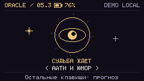
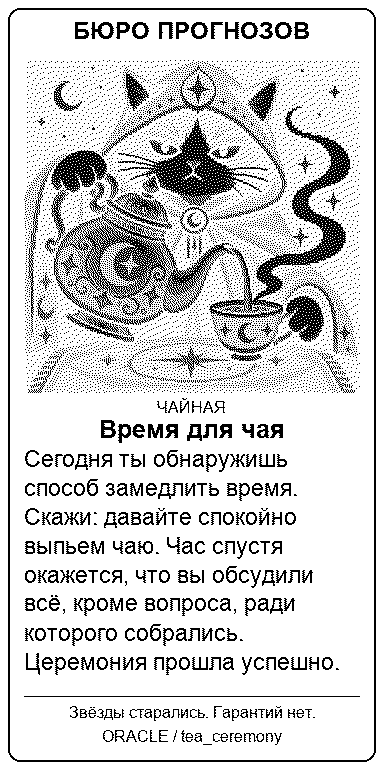

# Oracle ADV

**Карманный оракул для M5Stack Cardputer ADV: предсказания с юмором, голосом, мистическими котами и чеком на память.**

Проект для доклада о нейросетях в баре. Нажимаешь кнопку — оракул тасует вероятности, показывает иллюстрацию, читает прогноз и пробует распечатать его на маленьком Bluetooth-принтере.

 

*Справа — интерфейс приложения в симуляторе. Значение батареи в снимке демонстрационное.*

## Возможности

| Тема | Содержимое | Интернет |
| --- | --- | --- |
| Айти и юмор | 60 готовых предсказаний про работу и жизнь | Не нужен |
| Пивная | 30 предсказаний для вечера в баре | Не нужен |
| Чайная | 30 предсказаний про чай и маленькие ритуалы | Не нужен |
| Таро / AI | Вопрос с клавиатуры, три разных аркана и новое толкование | Wi-Fi + LiteLLM |

- Все **120 текстов, 120 WAV, девять картинок и 120 растров чеков** включены в репозиторий.
- В каждой автономной теме своя очередь без повторов. С SD читается только выбранная карточка.
- Магические эффекты синтезируются на устройстве; речь подготовлена заранее в ElevenLabs.
- Текст прокручивается автоматически или с клавиатуры. В шапке — процент батареи, обновление каждые пять секунд.
- Печать на **BQ95 / FunPrint** по Bluetooth LE: иллюстрация шириной 336 точек на бумаге шириной 384 точки.
- Без SD доступны по шесть резервных текстов каждой автономной темы, без озвучки и печати.

Локальная нейросеть на ESP32 пока не запускается. Автономные прогнозы подготовлены заранее, Таро обращается к модели через HTTPS. Маленькая локальная модель — возможный следующий этап.

## Запуск на устройстве

Нужны **Cardputer ADV**, microSD с FAT32 и установленный **M5Apps**. Проект ориентирован на ADV с ESP32-S3; обычный Cardputer этой прошивкой не поддерживается.

1. Соберите прошивку или возьмите подготовленный пакет. Текущая версия — [0.5.3](VERSION).
2. Скопируйте содержимое [sdcard](sdcard) в корень карты: получится каталог /ORACLE.
3. Скопируйте application image firmware/.pio/build/oracle-adv/firmware.bin в корень SD под именем ORACLE.BIN.
4. В M5Apps откройте **Installer → SD → ORACLE.BIN**. Не выбирайте служебный файл macOS с префиксом ._.
5. Запустите приложение: в шапке должно быть **ORACLE / 05.3** и **SD**.

Для трёх готовых колод ключи не нужны. Для Таро скопируйте sdcard/ORACLE/config.example.json в /ORACLE/config.json на карте и заполните свои настройки. Реальный config.json исключён из Git.

[Установка](docs/INSTALL.md) · [Таро и Wi-Fi](docs/TAROT.md) · [Проверка устройства](docs/DEVICE_CHECK.md)

## Управление

| Где | Кнопки | Действие |
| --- | --- | --- |
| Главный экран | Лево / право, физические , и / без Fn | Переключить тему |
| Главный экран | Остальные клавиши / Go | Прогноз или ввод вопроса для Таро |
| Ввод вопроса | Tab / Shift / Backspace | RU–EN / регистр / удалить символ |
| Ввод вопроса | Enter / Go | Отправить; пустой вопрос даёт общий расклад |
| Результат | Enter / пробел / N | Новое предсказание |
| Результат | ; или W / . или S | Прокрутить вверх / вниз |
| Результат | P | Найти принтер и напечатать ещё одну копию |
| Результат | R / I / A | Повторить голос / показать картинку / автопрокрутка |
| После запуска | M / + / − | Выключить звук / изменить громкость |
| Внутри приложения | Esc, физическая клавиша обратной кавычки | Назад / отменить |

В теме Таро голос для нового текста пока не генерируется. Повторная печать использует полученный расклад и не отправляет новый запрос модели.

## Печать

На BQ95 откройте **FunPrint с QR-кодом** и отключите автовыключение. При раскрытии прогноза выполняется одна автоматическая попытка печати; **P** повторяет поиск или печатает дополнительную копию. Одновременно отправляется один чек. После обрыва он автоматически не повторяется.

Драйвер привязан к проверенному экземпляру BQ95. Для другого устройства нужно адаптировать идентификатор в firmware/src/bq95_printer.cpp; совместимость со всеми китайскими принтерами не заявляется.

[Протокол, ограничения и исправление NVS/M5Apps](docs/PRINTER_BQ95.md).

## Сборка

Python **3.10+**, PlatformIO. Команды ниже подходят для macOS/Linux.

~~~sh
python3 -m venv .venv
source .venv/bin/activate
python -m pip install -r requirements.txt
python -m pip install platformio

python -m unittest discover -s tools -p test_pack.py
cd firmware
pio run -e oracle-adv
cd ..
python tools/package_demo.py
python tools/validate_release.py
~~~

Готовые BIN и ZIP появятся в release/, которая не коммитится. Упаковщик берёт только ресурсы активной колоды и публичные инструкции. Корневой [VERSION](VERSION) задаёт версию пакета; видимый номер прошивки обновляется отдельно при выпуске версии.

Лимит application image для используемого слота M5Apps — **1 310 720 байт**. Сборка проверяет его автоматически. Прошивка 0.5.3 занимает **1 246 832 байта**, статическая RAM — **72 768 байт**.

[Среда разработки, симулятор и native-тесты](docs/DEVELOPMENT.md).

## Структура

~~~text
firmware/       C++17: экран, карточки, звук, Wi-Fi, Таро и BLE
content/        исходная колода
assets/         оригиналы иллюстраций, промпты и назначения карточкам
sdcard/ORACLE/  готовые карточки, WAV, JPEG, чеки и пример настроек
tools/          подготовка ресурсов, проверки, упаковка и сборка сайта
site/           HTML-шаблон и CSS страницы проекта
docs/           инструкции и выбранные иллюстрации документации
third_party/    лицензии заимствованных компонентов
.github/        проверки и ручная публикация GitHub Pages
local/          личные заметки, диагностика и инструменты — вне Git
release/        пакеты и приватные настройки — вне Git
build/          промежуточные файлы и готовый сайт — вне Git
~~~

Источники и готовый набор SD хранятся вместе намеренно: чистого клона достаточно для работы без платной генерации. Все 120 WAV входят в Git как обычные бинарные файлы; Git LFS не требуется.

## Контент

[content/deck.json](content/deck.json) — источник текстов; [assets/artwork.json](assets/artwork.json) связывает их с картинками. [Происхождение иллюстраций](assets/PROVENANCE.md) содержит промпты генерации.

~~~sh
# После изменения иллюстраций:
python tools/prepare_images.py
# После изменения карточек:
python tools/prepare_pack.py --ready-only --require-media
python tools/prepare_receipts.py
~~~

Генерация новых голосов требует переменной окружения ELEVENLABS_API_KEY и расходует лимит ElevenLabs. Скрипт продолжает работу по хешам содержимого, пропуская готовые записи:

~~~sh
python tools/generate_audio.py --pause-seconds 15
~~~

.env сам по себе не загружается скриптами: передайте ключ через окружение терминала или менеджера секретов. Сборка существующей колоды ElevenLabs не вызывает.

[Добавление карточек и требования к ресурсам](docs/CONTENT.md).

## Сайт и GitHub Pages

Статическая страница с оригинальными иллюстрациями, тремя реальными примерами озвучки и чеком. Сайт не обращается к LiteLLM и не получает ключи устройства.

~~~sh
python tools/build_site.py
python -m http.server 8765 --bind 127.0.0.1 --directory build/site
~~~

Открыть http://127.0.0.1:8765/. Для ссылки на свой репозиторий передайте --repository OWNER/REPOSITORY. Пути относительные: работают корневой домен и адрес OWNER.github.io/REPOSITORY/.

После загрузки репозитория на GitHub:

1. **Settings → Pages → Source → GitHub Actions**.
2. **Actions → Deploy GitHub Pages → Run workflow**.
3. Адрес публикации появится в результате задания.

Публикация ручная. При push / pull request выполняются проверки контента, состава Git и сборки сайта; публикации нет. Workflow отправляет только build/site. [Подробнее](docs/PAGES.md).

## Приватные данные

Исключены .env* (кроме пустого примера), настоящие config.json, ключи, заметки, прошивки, дампы, резервные копии и логи. Публичный roots.pem содержит сертификаты удостоверяющих центров, не приватные ключи.

~~~sh
python tools/check_repo.py
# Необязательно: включить проверку как локальный pre-commit hook.
git config core.hooksPath .githooks
~~~

Проверка читает именно Git-индекс и не выводит значения секретов. Если локальный приватный конфиг существует, его реальные токен и пароли также проверяются в коммитируемых файлах.

## Состояние

Прототип. Логика, контент, сборка, интерфейс симулятора и протокол печати проверены. Физически подтверждён полный чек BQ95, отправленный с Mac. Версия 0.5.3 записана на SD; исправление печати на Cardputer, реальная батарея и переходы BLE → Wi-Fi → BLE ещё требуют проверки на устройстве.

[ROADMAP.md](ROADMAP.md): настройка Wi-Fi с клавиатуры и сохранением только успешных подключений, новые способы генерации и аппаратная проверка.

## Заимствования

Кириллический шрифт и UTF-8-хелперы происходят из Hermes Terminal (MIT). Уведомления NimBLE, Apache NimBLE и TinyCrypt сохранены в [third_party](third_party). Лицензия собственного кода проекта пока не выбрана.
