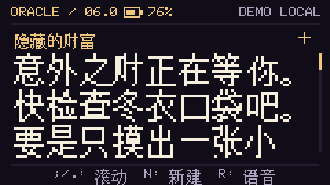

# Chinese text rendering

The `zh` build uses the /efont/ Biwidth 12px BDF distributed by U8g2.
The original BDF, download URL and SHA-256 are retained in `assets/fonts/`.
Redistribution terms and copyright notices are in `third_party/Efont-LICENSE`.

`python tools/chinese_font.py` generates both an embedded subset and a full SD
glyph book. The release builder runs this step automatically for Chinese.
Pillow is required. Missing characters in Chinese content fail validation.

The embedded subset covers the Chinese source UI and all offline fortunes.
Additional CJK characters from an AI response are looked up individually in
`ORACLE/fonts/chinese12.bin` using a bounded binary search. Hardware serializes
font reads with a mutex and keeps a 32-entry glyph cache. It never loads the
whole font into RAM. An unavailable glyph causes an AI reading to be rejected;
the low-level renderer uses an outlined box if called with an unsupported glyph.

The `OCF1` file is little-endian: 4-byte magic, 32-bit record count, 32-bit CRC32
of the records. Each sorted 26-byte record has a 16-bit Unicode code point and
twelve 16-bit bitmap rows. The low twelve bits hold pixels, with bit 11 at left.
Source baseline is 10, descent 2. CJK characters occupy two 6px columns;
Latin and Cyrillic occupy one. The display uses three 24px-high text rows with
26px spacing. Chinese closing punctuation stays with the preceding character.

Offline receipt generation uses the same BDF and double-width metrics. Runtime
Tarot receipt generation uses the display glyph reader in 32-row strips, with
separate line heights for 36px body text and 24px questions. Both remain within
the 384 × 1024-dot receipt limit.

English remains the default build. Simplified Chinese is the supported Chinese
localization; traditional Chinese content and a Chinese keyboard IME are not
provided. Users can type an English/Pinyin Tarot question or leave it empty.
